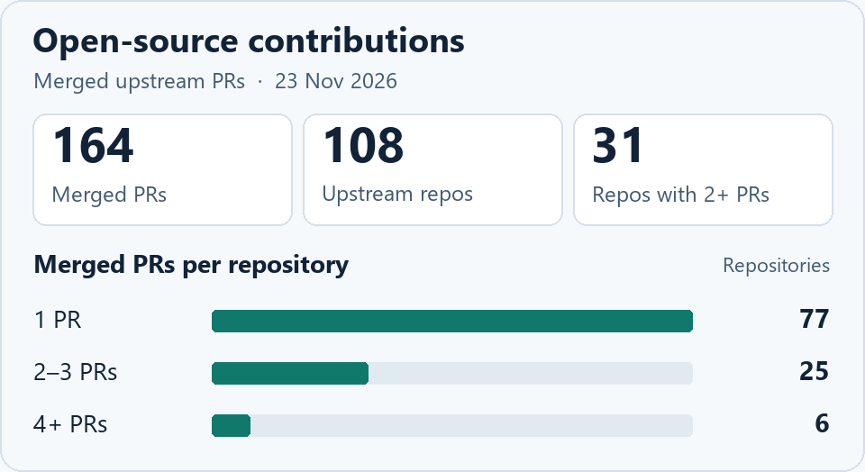

# Cristian Chiriac

Cybersecurity engineer working on detection engineering, threat hunting, and digital forensics.

## Selected upstream work

- **[Apache CALDERA #3417](https://github.com/apache/caldera/pull/3417)** — fixed the documented Git command for checking out a specific CALDERA release.
- **[Splunk Sigma backend #77](https://github.com/SigmaHQ/pySigma-backend-splunk/pull/77)** — fixed Boolean precedence so generated SPL and SPL2 searches match the scope of the original Sigma rule.

## Independent project

**[Local Mail Guardian](https://github.com/cristianchiriac/Yahoo-IMAP-Spam-Cleaner)** scans Yahoo Mail locally for phishing and spam, shows which signals flagged each message, and runs in dry-run mode by default.

[ORCID](https://orcid.org/0009-0006-0583-046X)

## Open source contributions

<picture>
  <source media="(prefers-color-scheme: dark)" srcset="contribution-overview-dark.png">
  
</picture>

<!-- BEGIN AUTO-GENERATED CONTRIBUTIONS -->
**164 merged pull requests** across **108 upstream repositories**.

[Browse merged pull requests on GitHub](https://github.com/search?q=author%3Acristianchiriac+is%3Apr+is%3Amerged&type=pullrequests)
<!-- END AUTO-GENERATED CONTRIBUTIONS -->

<!--
Enable after cristianchiriac/github-stats publishes overview.svg on its generated branch.

[Generated with jstrieb/github-stats](https://github.com/jstrieb/github-stats)
-->
